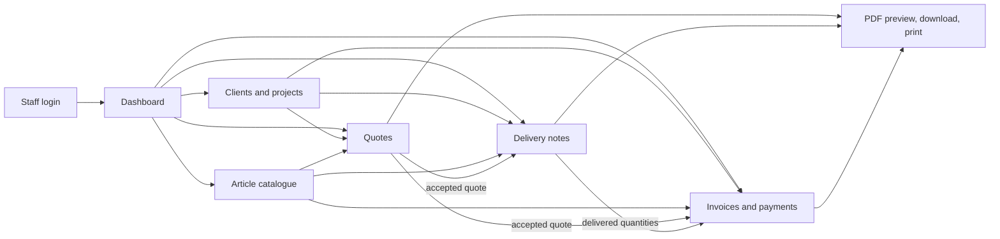

# AM Green Art document management blueprint

## Goal

Build a new, standalone private web app for AM Green Art to prepare, issue, edit as drafts, export, and track quotes, delivery notes, and invoices. Staff should choose items from a searchable catalogue, tick the required rows, enter quantities, and generate consistent French PDFs. This is a separate project from the existing AM Green Art website.

This blueprint is based on the provided bon de livraison, devis, and facture examples. Text inside those examples is treated as sample business content, not as instructions for the app.

## What the sample forms tell us

- **Bon de livraison:** document title, object/description, numbered line items, designation, unit, quantity, and a place for stamp and signature. The sample delivery note does not show a client block or a document number, so those should be confirmed and added to the app template.
- **Devis:** issue date and place, quote number, object, item reference/code, designation/specification, unit, quantity, unit price in DH, line amount, totals before and after VAT, amount in words, warranty note, and signature area.
- **Facture:** invoice number/date/place, client, client reference, object, item designation/specification, unit, quantity, unit price, line total, VAT totals, amount in words, and signature area.
- The sample documents share a recognizable company header and footer containing the company identity and contact/banking/tax details. Recreate and preserve these header/footer designs on every generated document; the app must not substitute a generic template. Store the underlying company details and logo/assets once in settings so the shared template stays consistent.

## Recommended product map

### Main screens

1. **Dashboard:** counts and value of drafts, quotes awaiting a reply, deliveries to complete, invoices unpaid/part-paid/paid, and recently updated documents.
2. **Clients:** legal/display name, billing and delivery addresses, contacts, ICE/IF/RC/TP when applicable, notes, and a history of linked projects and documents.
3. **Projects / worksites:** client, project title, site address/city, description, start/end dates, warranty notes, and related documents.
4. **Article catalogue:** search and filter by category, active/inactive state, name, botanical name, code, and unit. Add/edit items without touching code.
5. **Documents:** filter by type, number, client, project, date, status, and amount; open, duplicate, edit draft, download PDF, or record a status/payment update. Every generated document uses the supplied company header and footer design.
6. **Company settings:** logo, legal identity, address, contact details, footer identifiers, document language, default currency, tax configuration, and numbering format.

## Day-to-day workflow

1. Create or select the client and project/worksite.
2. Start a quote, delivery note, or invoice. For a quote, search the catalogue and tick one or more items; add quantity, unit, specification, and price. Allow a free-text one-off line when an item is missing, with an option to add it to the catalogue.
3. Save as a draft and preview the PDF. Drafts can be freely edited; totals and amount-in-words recalculate automatically.
4. Issue the document to assign its official number and freeze an issued snapshot. Download/print the PDF and record whether it was sent.
5. Mark a quote accepted/rejected. An accepted quote can prefill a delivery note or invoice. The user reviews delivered quantities before issuing the next document.
6. Track delivery progress and invoice payment state. Record payment date, method, amount, and reference; show remaining balance.
7. Keep a document timeline: created, edited, issued, sent, accepted/rejected, delivery updated, payment received, and cancelled/corrected.

## Catalogue starter data

Create seed rows as **suggestions without assumed current market prices**. Admin confirms local names, grades/specifications, units, and default prices before using them. The quote sample supplies the first verified entries; extend with commonly used landscaping categories below. The catalogue supports document line selection only; the first release does not track stock or deduct inventory.

| Category | Suggested items to preload | Typical units |
|---|---|---|
| Trees and palms | Washingtonia robusta (several stem heights/ages); Jacaranda mimosifolia; Ficus benjamina; Ficus nitida; other locally sourced ornamental/fruit trees | U |
| Shrubs and hedges | Coprosma lucida; Lonicera sp.; Ligustrum ovalifolium; Nerium oleander; Hibiscus; Bougainvillea; Lantana; Plumbago | U, ml, m² |
| Flowering/foliage plants | Arbre ombrelle; Belle-de-nuit; Plectranthus; Croton; seasonal mixed plants | U, pot |
| Lawn and ground cover | Pennisetum clandestinum; locally stocked lawn seed/turf; low ground-cover plants | m², kg, U |
| Soil and amendments | Terre végétale; decomposed manure; compost; fertilizer | m³, kg, bag |
| Irrigation | Drip line, pipe, connectors, valves, sprinklers, filter, controller, pump, installation/maintenance service | m, U, lot, h |
| Services | Site preparation, planting, lawn installation, pruning, palm trimming, phytosanitary treatment, fertilizing, maintenance visit, landscape design/follow-up | m², U, h, forfait |

Each catalogue item should have: internal code, French display name, category, optional botanical name, detailed specification/grade, base unit, optional alternate units, default sale price (MAD), optional VAT rate, active flag, and French/Latin search aliases. Do not treat the old quote's unit prices as today's price list. The UI and generated documents are French only.

## Document rules and data model

Keep a normalized database for editing, plus an immutable snapshot of the exact issued document lines and company/client details. Never regenerate an old issued PDF using changed catalogue or client data.

| Table | Purpose and important fields |
|---|---|
| `users` | Login identity, role (`admin`, `office`, `field`), active flag |
| `clients` | Name, contact details, billing/delivery address, optional tax identifiers |
| `projects` | Client, title, site address, object, dates, warranty notes |
| `catalog_items` | Code, names, category, specification, unit, default price/tax, active flag |
| `documents` | Type (`quote`, `delivery_note`, `invoice`), status, client/project, date/place, object, reference, currency, totals, tax mode, notes, source document, issued timestamp, PDF storage key |
| `document_lines` | Document, optional catalogue item, frozen code/name/specification/unit/quantity/unit price/tax/line amount, sort order |
| `number_sequences` | Per document type and year, transaction-safe next number |
| `payments` | Invoice, payment date, amount, method, reference, note |
| `document_events` | Actor, event type, timestamp, safe before/after details |
| `company_settings` | Logo and one authoritative company identity/footer profile |

Use `numeric`/decimal database columns for prices and totals, not floating-point values. Store currency as MAD and display “DH” in the French template. VAT is configurable in company settings and can be adjusted for a document or line when needed. If no VAT rate is configured, apply 20% automatically. Keep VAT calculations explicit in previews and PDFs; confirm applicable tax treatment with the accountant before production use.

Suggested statuses:

- Quote: `draft`, `issued`, `sent`, `accepted`, `rejected`, `expired`, `cancelled`.
- Delivery note: `draft`, `issued`, `partially_delivered`, `delivered`, `cancelled`.
- Invoice: `draft`, `issued`, `sent`, `partially_paid`, `paid`, `overdue`, `cancelled`.

Only drafts remain editable in place. Corrections after issue should preserve the original and use an explicit cancellation/correction workflow chosen with the accountant. Allocate official numbers only on issue, using a database transaction and a unique constraint per document type/year/number. Never reuse an issued number.

## Technical blueprint

This is a **new standalone project** and must not depend on, migrate, or modify the existing AM Green Art website. “Neo” is confirmed to mean **Neon Postgres**.

**Recommended stack:** build a fresh Next.js App Router application and deploy it on Vercel, with Neon Postgres, Drizzle ORM, and versioned database migrations. Use server-side Next.js actions/route handlers for protected writes. Keep the `DATABASE_URL` server-only; never connect directly from browser code. Generate PDFs on the server from shared French HTML/CSS templates that faithfully reproduce the supplied documents' exact company header and footer, typography, placement, and signature areas. Save issued PDF snapshots in object storage (Vercel Blob or another chosen store), while Neon stores document metadata, frozen content, and audit events. Next.js Route Handlers provide an API boundary; Neon's HTTP driver is designed for single-query/serverless requests, while interactive transaction flows need a transaction-capable connection approach.

Use server-side authentication with invitation-only accounts, role checks on every data-changing request, secure session cookies, audit events, database backups, and separate development/production Neon branches. Vercel preview deployments should use non-production database credentials/data.

## Build sequence

1. **Confirm remaining rules and fields:** verify the bon de livraison number/client/reference fields, numbering patterns, logo/stamp/signature assets and placement, and who can issue/cancel documents. The confirmed defaults are French only, no stock tracking, and VAT defaulting to 20% when no rate is configured.
2. **Foundation:** create the standalone Next.js app structure, configure Vercel and Neon environments, add auth/roles, company settings, schema, and migrations.
3. **Catalogue and clients:** CRUD, search, category filters, import-ready seed file, client/project pages.
4. **Document builder:** draft editor, checkbox catalogue selection, free-text line, quantity/price/tax calculations, French number-to-words, PDF preview and issue snapshot.
5. **Follow-up:** status timeline, quote conversion, delivery quantities, payment recording, filters and dashboard.
6. **Operational readiness:** import historical documents if requested, configure backups, review access, check printed PDFs on real devices, walk users through the app, then deploy to production.

## Decisions to confirm before implementation

1. What exact number format should be used for devis, BL, and factures? Does the BL need a client block, project/reference, delivery date, and recipient name/signature?
2. Which users/roles will use it, and should documents be emailed from the app or downloaded/shared manually in the first release?
3. Please provide any clean logo/signature/stamp image files that should be reproduced in the headers, footers, or signature areas if they are not embedded clearly in the sample forms.

## References for the target stack

- Next.js App Router and Route Handlers: https://nextjs.org/docs/app and https://nextjs.org/docs/app/getting-started/route-handlers
- Vercel's Next.js deployment support: https://vercel.com/docs/frameworks/full-stack/nextjs
- Drizzle's Neon drivers and HTTP/WebSocket guidance: https://orm.drizzle.team/docs/connect-neon
